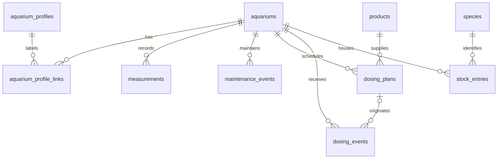

# Library and backup design

Date: 2026-10-18. Status: domain and full-snapshot backup **approved**; implementation not started.

## Scope and boundaries

Native Kotlin, Jetpack Compose, Material 3, MVVM, repository interfaces and Room; offline-first, multiple aquariums. No login, server, Google APIs or API keys in the Android application. Room is the source of truth, not a cache. PixelLab is an optional development-only paid artwork tool, never an APK dependency.

Planned dependency direction: `presentation -> domain <- data`. Presentation contains Compose screens and ViewModels with immutable UI state. Domain contains plain Kotlin models, repository contracts and use cases, with no Android imports. Data implements those contracts with Room entities/DAOs and explicit domain mappings. The app composition root wires dependencies. Use cases own validation and destructive-operation orchestration; UI never calls DAOs. Coroutines/Flow communicate changes; database transactions enforce integrity. Module names `:app`, `:domain`, `:data` are a proposal, not an existing scaffold.

## Ordered entity model

All entity IDs are stable UUID strings. Required unless marked `?`. Instants are UTC; display uses the device locale/timezone, while dosing recurrence preserves its own IANA zone. This is a logical schema, not executable SQL. SQLite representation/precision must be settled in the schema task, including lossless JSON roundtrips. Index every FK; use composite `(aquariumId, occurredAt)` indexes for histories, `(aquariumId, recordedAt)` for measurements, and both profile-link directions. Same-time history ordering uses the UUID as deterministic tie-breaker.

| Order | Table | Fields and constraints |
|---|---|---|
| 1 | aquariums | id PK, name, netLitres?, grossLitres?, notes?, createdAt. Supplied volumes positive; net <= gross when both known. |
| 2 | aquarium_profiles | id PK, name. Overlapping labels, not an exclusive aquarium type. |
| 3 | aquarium_profile_links | aquariumId FK, profileId FK; composite PK prevents duplicate assignment. |
| 4 | measurements | id PK, aquariumId FK, recordedAt, ph?, khDkh?, ghDgh?, no2MgL?, no3MgL?, tdsPpm?, temperatureC?. Null means unmeasured, never zero-by-default. |
| 5 | maintenance_events | id PK, aquariumId FK, type, occurredAt, changedLitres?, notes?. Type catalog is external data. |
| 6 | products | id PK, name. Products are shared library records. |
| 7 | dosing_plans | id PK, aquariumId FK, productId FK, dose, unit, frequency (daily/weekly), weekdays, startDate, endDate?, timeZone. Weekly days ISO 1..7, nonempty and unique. End >= start. |
| 8 | dosing_events | id PK, planId? FK, aquariumId FK, occurredAt, productNameSnapshot, dose, unit. Snapshot history must survive subsequent product/plan edits. |
| 9 | species | id PK, kind (fauna/flora), scientificName?, commonName. At least one meaningful identifying name; naming/duplicate policy is proposed below. |
| 10 | stock_entries | id PK, aquariumId FK, speciesId FK, quantity?, introducedAt, exitedAt?, notes?. Exit >= introduction; unknown quantity is null. |

### Validation and configuration

Canonical units: litres, Celsius, mg/L for NO2/NO3, dKH/dGH for hardness, ppm for recorded TDS (no assumed conductivity conversion), dimensionless pH. Dose units need an explicit catalog (for example mL, g, drops); never silently convert mass to volume or drops to mL. Finite numbers only, nonnegative measured concentrations/hardness/TDS, positive doses/known stock quantities. No arbitrary species-safe biological ranges; user-configured guidance is advisory and separate from structural validity. Temperature and pH validation must not confuse instrument validity with biological recommendations. Reject blank names, invalid UUIDs/dates/zones, unknown unit/type codes and orphan references at write/import boundaries. A measurement requires at least one non-null reading (proposal requiring confirmation).

Species, maintenance types, profiles, units, palette/prompts and future guidance belong in versioned external JSON content, not hardcoded source lists. User-entered content remains in Room; seed catalogs and their versioning are implementation work, not silently supplied biological advice.

### Open product decisions (proposals, NOT approved)

Prefer archive over destructive aquarium/product/species deletion; archived flags are not yet part of the approved model. Block referenced catalog deletion until semantics are confirmed. Explicit permanent aquarium deletion would require confirmed cascading histories; do not implement it implicitly. If plan deletion is approved, nullable planId can become null without deleting dosing events. Profile-link deletion removes only the label association. Species naming uniqueness and fractional plant quantities require a product decision. Date-only stock introductions vs instant precision also need confirmation before final schema. No notification time-of-day has been approved for dosing; recurrence must not invent one.

## Approved full-library backup

ZIP contains exactly `manifest.json` and `library.json` UTF-8 JSON. DTOs are separate from Room entities and migrations. `library.json` contains every approved table including empty arrays and profile links; no partial aquarium backups or merges in v1. Manifest carries formatVersion, appVersion, UTC createdAt, per-table counts and SHA-256 of the exact library.json bytes. Proposed format identifier: `aquarium-manager-library`; proposed initial formatVersion: 1. App version is diagnostic; restore compatibility is decided by supported format versions, not string comparison of app versions. Checksums detect accidental corruption, NOT authentication or malicious tampering. ZIP is **unencrypted**; anyone with file access can read notes and histories. UI must disclose this before export/destination selection.

### Export sequence and consistency

1. Serialize exports/restores/writers through an application-level coordinator. Obtain all tables in one coherent Room read transaction; detach DTOs before slow file-provider I/O. Bound memory/size with tested library limits.
2. Serialize and hash exact bytes; create ZIP in private temporary storage; reopen and fully verify names, counts, JSON and checksum.
3. Create a uniquely named destination document, copy, close and read back the destination to verify the actual provider bytes. Success is reported only then. SAF providers need not support atomic rename; never overwrite the last valid file. Remove incomplete new documents best-effort and show failures.
4. Retain the previous valid backup until the new destination is verified. Cancellation, process death, out-of-space, revocation, unavailable media and interrupted provider writes cannot count as success.

Manual: SAF create/open document picker, not hardcoded filesystem paths. Automatic: user chooses a document tree, persist its grant and use WorkManager for daily **best-effort**, not exact-clock execution. A daily interval and seven verified automatic generations are proposed defaults needing product confirmation. Retention applies only after successful verification, only to app-created generations, never arbitrary user files/manual backups. If no permission remains, pause and show actionable status; destination/scheduling metadata stays device-local and is not exported. No network or Google API integration is involved (the user-selected document provider may itself be cloud-backed, outside the app's control).

### Restore sequence and safety

Bounded streaming ZIP inspection before extracting: exact entry allowlist, reject duplicates, traversal names, directories, encryption, unsupported compression, excessive entry/uncompressed sizes and expansion ratio. Proposed starting ceilings: 2 entries, 64 KiB manifest, 50 MiB library, 100:1 ratio and 250,000 total rows; these are resource limits to validate on target devices, not approved product limits. Strict JSON validation checks supported format, required/known fields per format, finite types, duplicate UUIDs, enums, counts, hash and every FK. Reject unsupported future/newer formats; supported older formats need explicit DTO migrations and fixtures. Invalid data must never reach live tables.

Preview timestamp, counts and full-library replacement warning. Require explicit **Replace library** confirmation; never merge automatically. Acquire exclusive writer gate, make and verify a safety snapshot of the current library before any mutation (abort if this fails). Preserve that safety snapshot outside the replacement transaction. Replace child/parent records in FK-safe order inside one Room transaction, with rollback on all failures. Release gate only after completion; process restart must recover coherently. Existing UI readers must receive refreshed state, not stale selected IDs. Preserve this device's destination grant, schedule and local preferences; imported library data cannot redirect backup paths. Test export/import/export semantic equality, rollback after injected mid-import failure, safety-backup failure, concurrent edits, revoked grants and process interruption.

## Delivery boundaries

Beads is the only task tracker; its issues carry implementation acceptance and test requirements. First ship reproducible Android foundation and migration-tested repositories; then feature slices; then validated manual snapshots; then SAF automation. PixelLab tooling is independent and does not imply visual identity approval. No Android source, Gradle wrapper, launcher XML, migration or backup engine is implemented by this planning delivery.
